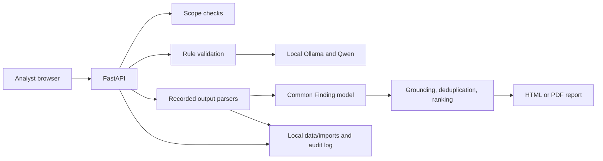

# RedPencil Architecture

## Current Prototype

RedPencil is a local FastAPI application with a plain HTML/JavaScript interface. Its AI component uses Qwen through a local Ollama HTTP server. The model proposes assessment steps; it does not execute tools, interpret imported findings, or generate vulnerability evidence.

## Request and Planning Flow

1. The browser sends the objective, target list, and exclusions to `POST /api/assessment/start`.
2. The backend checks that each target is syntactically inside the submitted scope. This is not independent proof of authorization.
3. `AssessmentPlanner` requests JSON recommendations from Ollama's local `/api/chat` endpoint using `OLLAMA_BASE_URL` and the selected installed model tag. `OLLAMA_MODEL` is the preferred default (defaults: `http://127.0.0.1:11434` and `qwen3.5:4b`).
4. The backend accepts only Nmap, Nessus, Nikto, or OWASP ZAP recommendations and exact targets from the submitted list. It supplies the action text itself; command-like or unsupported model rationale is replaced with neutral text. Invalid structure, unsupported tools, or unavailable Ollama falls back to a deterministic plan, which is labeled in the response.
5. Starting an assessment runs no scanner. The API returns `PLANNED` and `tools_executed: 0`.

## Evidence Import and Reports

`POST /api/evidence/import` accepts one recorded export as JSON content, limited to 2 MB. Supported formats are Nmap XML, Nessus XML, Nikto JSON, and OWASP ZAP JSON. Parsers normalize supported fields into `Finding`; XML DTD/entity declarations are rejected. Imported findings must remain within the submitted scope, and any CVE identifier must occur in the raw export.

The original file is stored under the git-ignored `data/imports/` directory. Findings keep the original filename and local reference. Duplicate findings merge their evidence and retain all source references. The report distinguishes imported records from live execution and discloses that authorization and findings were not independently verified. PDF output depends on a local renderer; HTML is the fallback.

## State and Audit

Assessment and approval state is held in process memory and reset on a new assessment or server restart. Imported files, generated reports, and the JSONL audit log are local under `data/`. The audit records analyst requests, plan decisions, scope checks, and imports. This prototype is intended for a single local demo, not concurrent users or production deployment.

## Security Boundaries

- The model is advisory. It cannot invoke tools or expand the backend's available-tool list.
- The target list is user-entered. A human must verify written authorization and lab boundaries separately.
- No live scanning, exploitation, or active validation is implemented.
- The approval-gate module records and checks approval decisions but is not connected to any executable validation action.
- Imported scanner output is untrusted input. File size and XML declaration checks are enforced; findings are rendered as text in the browser.
- Do not commit raw exports, generated reports, credentials, or audit records.

## Integration Status

See [integration_matrix.md](integration_matrix.md) for per-tool support and limitations. No tool currently has live execution support.
